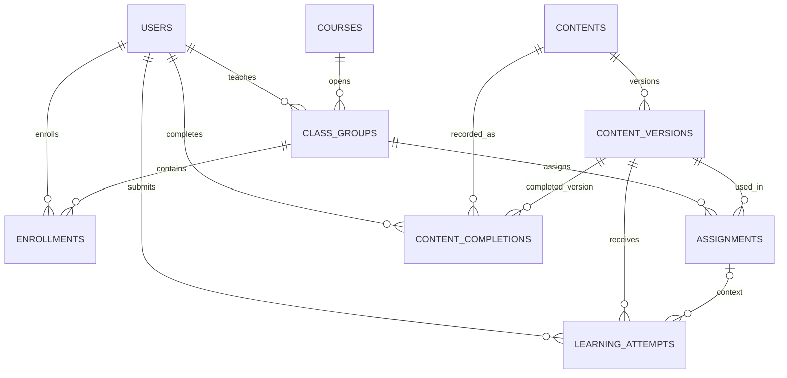
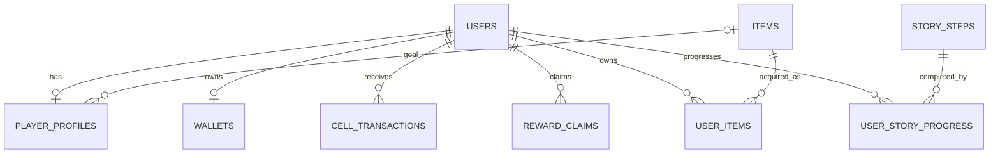

# 도로버스 DB 설계 제안 초안

작성일: 2026-11-02 · 검토 대상: `database_dorobus-main`

이 문서는 현재 코드에서 확인한 동작을 바탕으로 만든 논리 설계 제안이다. 실제 DB가 생성된 상태는 아니며, DB 제품과 자료형을 확정하기 전 팀 검토용으로 사용한다. 원본 프로젝트 파일은 수정하지 않았다.

## 1. 현재 프로젝트에서 확인한 내용

| 영역 | 현재 구현 | DB 설계에 주는 의미 |
|---|---|---|
| 계정 | 학생·강사 체험 계정이 `accounts.js`에 정의됨 | 사용자와 역할을 저장하고 실제 인증을 연결해야 함 |
| 저장 | `store.jsx`에서 계정별 CELL·가구·progress를 localStorage에 저장 | 사용자별 영구 저장 구조와 서버의 처리 규칙이 필요함 |
| 수업 | 레벨 1~8 과정, 강사 표시명·수강 인원·시작일, 현재 선택한 수업 1개 | 과정 정보와 실제 개설 반, 수강 이력을 구분하는 설계를 권장 |
| 과제 | `courses.js`의 ASSIGN이 `content.js`의 문제를 선택 | 문제와 과제 배정을 별도 테이블로 구성 |
| 완료 | contentDone에 문제 ID를 저장하고 여러 수업에서 같은 완료 여부를 사용 | 현재 동작을 유지하려면 학생별 문제 완료 기록을 기준으로 조회 |
| 시도 | 미션별 tries·wrong 집계, 일부 미션은 단계별 키 사용 | 제출별 원본 기록을 추가하면 시각·답변·단계별 분석이 가능 |
| 스토리 | 단계별 boolean, 수집 부품, 면허, 자유 응답 | 단계 완료·수집·사용자 응답을 의미에 맞게 분리 |
| 생활 콘텐츠 | 출석·일일 퀘스트·스탬프·탈것·배지 | 날짜별 기록과 보상 중복 방지 필요 |
| 경제 | CELL 지급·구매·시설 강화·운영 수익 | 잔액과 변동 내역을 함께 관리하고 관련 처리를 한 번에 확정 |
| 친구 방 | 같은 브라우저의 다른 계정 저장 데이터를 조회·수정 | 사용자 간 공유 데이터와 공개 범위를 서버에서 관리 |
| 보물찾기 | 숨긴 CELL, 탐색 횟수, 발견자, 좋아요 | 방 설정과 개별 게임 회차, 탐색 기록을 구분 |

공지·자료·영상·강의 평가는 화면이 있지만 일부가 안내 문구나 예시 목록이다. 파일 업로드, 실제 영상 시청 기록, 강사 관리 화면이 완성된 것으로 보지는 않았다. `server/`는 확인한 문서상 정적 사이트 배포·운영용이며, 애플리케이션용 DB API는 확인되지 않았다.

## 2. 설계 원칙

1. 화면별로 테이블을 만들지 않고 데이터의 의미별로 나눈다. 마이룸과 상점은 같은 보유 가구·CELL 데이터를 사용한다.
2. 공통 정의와 개인 기록을 나눈다. 상품과 학생의 구매 내역, 문제와 학생의 답안은 별개다.
3. 반복되는 기록을 배열 한 칸에 계속 누적하지 않는다. 수강·풀이·보유 가구·출석은 각각 행으로 저장한다.
4. 학습·재화·사용자 간 상호작용은 관계와 제약조건이 명확한 테이블을 우선 사용한다. 문제의 유형별 본문, 자주 바뀌는 비핵심 화면 설정은 JSON을 사용할 수 있다.
5. 보상·구매·발견 처리는 서버에서 검증하고, 여러 데이터가 함께 바뀌면 하나의 트랜잭션으로 확정한다. 트랜잭션은 관련 작업을 전부 성공시키거나 전부 취소하는 단위다.
6. 현재 동작을 유지할 항목과 변경할 정책을 구분한다. 특히 같은 문제의 완료를 수업 간 공유할지 먼저 정한다.

## 3. 권장 핵심 테이블

PK는 각 행을 구별하는 기본키, FK는 다른 테이블의 행을 연결하는 외래키다. 아래 컬럼은 핵심 후보이며, 표의 나열 순서는 실제 구현 순서를 의미하지 않는다.

| 테이블 | 용도 | 주요 컬럼 후보 |
|---|---|---|
| users | 사용자 | id(PK), login_id(고유), display_name, role, auth_subject(인증 연결용 고유값), created_at |
| courses | 재사용할 교육 과정 | id(PK), code(고유, 예: l1), title, track, level, description, is_active |
| class_groups | 실제 개설 반 | id(PK), course_id(FK), teacher_id(FK→users), name, starts_on, ends_on, status |
| enrollments | 학생의 수강 이력 | id(PK), user_id(FK), class_group_id(FK), status, enrolled_at, completed_at |
| contents | 재사용할 문제·학습 활동의 고정 식별자 | id(PK), code(고유, 예: q-sensor), kind, concept, is_active |
| content_versions | 출제 당시 문제 내용 | id(PK), content_id(FK), version, title, public_body(JSON), grading_rule(JSON, 서버 전용), published_at |
| assignments | 반에 배정한 과제 | id(PK), class_group_id(FK), content_version_id(FK), assigned_on, due_at(선택), sort_order |
| learning_attempts | 제출 1회 또는 단계 답변 1회 | id(PK), user_id(FK), content_version_id(FK), assignment_id(FK, 선택), step_key(선택), scope, answer(JSON), is_correct, submitted_at, request_id |
| content_completions | 학생이 완료한 문제 | user_id(PK·FK), content_id(PK·FK), completed_version_id(FK), completed_at |
| story_steps | 스토리 단계 정의 | id(PK), code(고유, 예: carCheckDone), chapter, title, sort_order |
| user_story_progress | 학생별 스토리 단계 완료 | user_id(PK·FK), story_step_id(PK·FK), completed_at, response(JSON, 선택) |
| player_profiles | 현재 선택·게임 설정 | user_id(PK·FK), selected_class_group_id(FK, 선택), active_world_content_version_id(FK, 선택), goal_item_id(FK, 선택), preferences(JSON), updated_at |
| wallets | 현재 CELL 잔액 | user_id(PK·FK), balance, updated_at |
| cell_transactions | CELL 증감 내역 | id(PK), user_id(FK), amount(증가 +, 감소 -), reason, operation_id, created_at |
| items | 상점 가구 정의 | id(PK), code(고유, 예: plant), name, price_cell, is_active |
| user_items | 학생이 보유한 가구 | user_id(PK·FK), item_id(PK·FK), acquired_at, purchase_price_cell(선택) |
| reward_claims | 보상 지급 여부 | id(PK), user_id(FK), reward_key, operation_id, cell_amount, claimed_at |

수업 관련 이름은 이 문서에서 다음처럼 구분한다.

- 과정: ‘AI K-POP 프로듀싱 작전’이라는 교육 내용.
- 개설 반: 그 과정을 특정 기간에 특정 강사가 운영하는 반. 현재 코드의 course/CLASS_INFO에서 분리하는 제안이다.
- 수강 기록: 어떤 학생이 어떤 반에 참여했는지.
- 선택한 반: 화면에서 지금 보고 있는 반. 수강 이력 전체와 별개다.

현재 한 개 수업만 선택하는 화면은 그대로 유지하면서도 enrollments에는 과거 수강 기록을 남길 수 있다. 실제로 동시 수강을 1개로 제한할지는 별도 업무 규칙이다. 강사 여러 명이 한 반을 담당한다면 class_group_teachers 연결 테이블로 확장한다.

### 학습 영역 관계도

### 게임·상점 영역 관계도

관계도는 주요 연결만 표시한 것이다. 선택한 반·월드 과제 등의 세부 FK는 테이블 정의서를 작성할 때 함께 표시한다.

## 4. 도로버스에서 먼저 결정할 중요한 규칙

### 같은 문제를 여러 수업에서 냈을 때

현재는 q-sensor를 한 번 완료하면 그 문제를 쓰는 다른 수업에서도 완료로 표시된다. 이 동작을 유지하는 것이 기본 제안이다.

- 문제 자체: contents에 한 번 정의한다.
- 각 반의 출제: assignments에 별도로 저장한다.
- 학생의 완료: content_completions에서 `(user_id, content_id)`를 고유하게 관리한다.
- 보상: `content:q-sensor:first-clear`처럼 범위를 알 수 있는 키로 한 번 지급한다.
- 과제를 보고 풀었다면 learning_attempts.assignment_id에 출제 맥락을 남긴다. 직접 문제에 접근한 경우에는 비워 둘 수 있다.

수업마다 다시 풀어야 한다면 assignment_submissions를 추가하고 `(user_id, assignment_id)` 단위로 완료를 판단한다. 이 경우 수업 간 완료 공유 정책도 바뀐다. 문제를 크게 개편해 재완료가 필요할 때는 새 content 식별자를 발급하거나, 버전별 완료 정책으로 변경해야 한다.

ASSIGN의 날짜는 화면에서 ‘출제’로 표시되므로 assigned_on에 대응시킨다. 이를 임의로 마감일로 해석하지 않는다. 마감일이 필요하면 due_at을 별도로 정한다.

### 풀이 기록과 스토리 완료는 구분

‘문제에서 정답을 골랐다’와 ‘해당 스토리 단계가 끝났다’는 다른 사실이다. 단계별 시도는 learning_attempts에, 최종 스토리 완료는 user_story_progress에 남긴다. 시도 기록으로 스토리 완료를 임의로 추정하지 않는다.

현재의 `${문제ID}-${단계번호}` 문자열은 content_version_id와 step_key로 분리하는 것을 권장한다. scope는 step 또는 activity로 구분해 단계별 답변과 전체 완료 횟수를 섞어 세지 않는다. 스토리 미션·HOMEWORK·코딩 챌린지도 학습 분석 대상이면 별도의 contents 항목으로 등록해 같은 풀이 구조를 사용한다.

현재 recordAttempt는 누적 횟수와 오답 수만 보관한다. 일반 퀴즈 제출은 이 함수를 호출하지 않는다. DB 연결 시 일반 퀴즈에도 제출 기록을 추가해야 하며, 기존 집계로 과거 개별 답변이나 시각을 복원할 수는 없다.

문제 수정 시 과거 풀이의 의미가 바뀌지 않도록 출제에는 content_versions를 연결한다. 공개된 버전의 채점 기준을 변경할 때는 새 버전을 만든다. 제출의 assignment_id가 있는 경우 해당 과제의 content_version_id와 일치하는지 서버에서 검사한다. 완료 기록의 completed_version_id도 같은 content에 속해야 한다.

### CELL은 잔액과 내역을 함께 관리

가구 구매 예시:

1. 서버가 상품 가격·판매 여부·기존 보유 여부를 확인한다.
2. 사용자의 잔액을 잠그거나 조건부 갱신으로 구매 가능 금액을 확보한다.
3. 잔액을 차감하고 user_items를 생성하며 cell_transactions를 기록한다.
4. 관련 작업이 모두 성공하면 확정한다. 실패하면 전부 취소한다.

단순히 마지막 잔액을 덮어쓰면 동시에 실행한 구매나 보상이 사라질 수 있다. 잔액과 거래 내역은 같은 트랜잭션에서 갱신하고, 잔액은 0 이상이어야 한다. 실제 구매 가격은 구매 당시 값으로 남긴다.

요청 재전송은 operation_id 또는 request_id로 중복 처리를 막는다. 요청 ID와 별도로 ‘같은 문제 첫 완료 보상은 한 번’ 같은 업무 중복도 reward_claims의 고유키로 막는다. 한 작업이 여러 지갑에 내역을 만들 수 있으므로 거래 내역의 고유 범위는 `(user_id, operation_id)`로 둔다. 복합 보상이 있다면 스탬프·아이템 지급도 같은 작업에 포함한다.

### 날짜와 공개 범위

- 출석·방문·일일 보상의 날짜 경계는 서비스 기준 시간대인 Asia/Seoul로 통일한다. 서버가 날짜를 판정한다.
- 실제 발생 시각은 시간대가 있는 시각으로 저장하고, 일일 고유키에는 서비스 기준 날짜를 사용한다.
- 앱 접속 출석과 실제 수업 출석은 의미가 다르다. 후자가 필요하면 반·차시를 연결한 별도 기록을 둔다.
- 방 방문자는 공개된 이름·가구·게임 상태를 조회한다. 계정 정보·학습 답변·채팅·보물 정답 위치는 공개 응답에서 제외한다.
- 방문자는 친구 지갑을 직접 수정하지 않고 방문 요청을 보낸다. 서버가 방문 자격과 중복 여부를 확인하고 보상을 지급한다.
- 학생은 본인 데이터, 강사는 담당 반 학생의 필요한 학습 기록에 접근하도록 권한을 구분한다. role 문자열만 클라이언트에서 고르는 것으로 권한을 부여하지 않는다.
- 실제 비밀번호는 프런트 코드나 일반 문자열 컬럼에 저장하지 않는다. 인증 서비스 연결 또는 서버의 비밀번호 해시 검증으로 대체한다.

## 5. 후속 기능의 추가 테이블

아래는 현재 존재하는 기능을 서버에 연결할 때 필요한 후보다. 해당 기능을 실제 사용자에게 제공하기 전에 구현한다.

| 기능 | 테이블 후보 | 핵심 규칙 |
|---|---|---|
| 앱 접속 출석 | attendance_records(user_id, attendance_date, checked_in_at) | 사용자·날짜당 한 번 |
| 일일 퀘스트 | daily_activity_totals, daily_unique_targets, daily_quest_claims | 횟수·고유 대상 수·최고 점수를 구분하고 사용자·날짜·퀘스트별 한 번 보상 |
| 스탬프·탈것·배지 | stamp_transactions, vehicles, user_vehicles, badges, user_badges | 획득 기록과 현재 선택을 구분. 스탬프를 쓰는 재화로 바꿀지는 기획 확정 |
| 수집 부품 | parts, user_parts | 사용자·부품별 획득 중복 제한 |
| 시설 설치·강화 | park_assets, user_park_assets, park_accounts | 사용자·시설별 상태와 마지막 수익 정산 시각 관리 |
| 오늘의 고장 수리 | daily_repairs | 사용자·서비스 날짜·시설별 완료 기록 |
| 작품 전시 | artworks | user_id와 course_id 또는 class_group_id로 연결. 제목·등록 시각 저장 |
| 친구 방 방문 | room_visits | 방문자·방 주인·날짜별 보상은 한 번, 자기 방 방문 제외 |
| 보물찾기 | room_games, treasure_rounds, treasure_searches, treasure_daily_limits | 방 설정·좋아요와 새로 숨길 때의 게임 회차를 분리 |
| 좋아요 | room_game_likes | 사용자·방 게임별 한 번. 새 회차에도 현재 코드처럼 좋아요 유지 |
| 미니게임 점수 | game_runs, game_best_scores | 모드·단계별 지표 구분. 코딩 챌린지는 블록 수가 적을수록, 피아노는 점수가 높을수록 좋음 |
| 보이드 대화 | robot_chat_messages | 사용자·대화 역할·내용·시각. 보존 기간은 별도 결정 |
| 실제 강의 운영 | lessons, lesson_views, announcements, course_materials, course_reviews | 화면의 안내를 실제 기능으로 구현할 때 구체화 |

보물찾기에서는 두 방문자가 동시에 같은 CELL을 가져가지 않도록 ‘아직 발견되지 않은 회차’를 한 명만 완료 처리할 수 있어야 한다. 회수·발견도 같은 회차를 잠그고 경쟁을 해결한다. 사용자·날짜별 횟수 제한은 해당 사용자 일일 제한 행을 잠그는 등 서버에서 동시 요청까지 처리한다. 현재 하루 방별 탐색 제한은 새 보물 회차가 시작돼도 사용자·방·날짜 기준으로 유지한다.

방문 보상의 중복 판단을 ‘최근 20개 방문 기록’에만 의존하지 않는다. 기록 보관·고유키로 지급 여부를 관리하고 화면에만 최근 20개를 보여 준다.

현재 작품 방문객 수와 시설 방문객 수는 시간·설치 상태로 계산한 게임 수치다. 실제 방문 이벤트 수로 이름 붙이거나 실제 접속 분석에 사용하지 않는다. 현재 계산 방식은 초기에는 서버에서 유지할 수 있으며, 시설 강화 전후 수익 단가를 어떻게 적용할지는 정책으로 정한다.

## 6. 제약조건과 조회 기준

| 대상 | 최소한의 무결성 규칙 |
|---|---|
| users | login_id 고유, 인증 식별자 고유 |
| enrollments | 같은 학생·같은 반 중복 등록 방지 |
| content_versions | 같은 content_id·version 중복 방지 |
| assignments | 같은 반·버전·출제 회차의 중복 배정 범위 결정 |
| learning_attempts | 사용자·request_id 고유, 서버 채점, 출제 맥락 일치 검사 |
| content_completions | 사용자·문제 고유, 완료 버전의 소속 문제 일치 |
| user_story_progress | 사용자·단계 고유, 선행 단계 검증 |
| wallets | 사용자당 한 개, balance >= 0 |
| cell_transactions | amount는 정수, 사용자·operation_id 고유, 확정 내역 임의 덮어쓰기 금지 |
| user_items | 현재 가구는 사용자·아이템 고유 |
| reward_claims | 사용자·reward_key 고유 |
| attendance_records | 사용자·서비스 날짜 고유 |
| room_visits | 보상 대상 방문은 방문자·주인·날짜 고유 |
| treasure_rounds | 방 게임당 진행 중 회차 최대 한 개 |

인덱스는 실제 조회에 맞춘다. 우선 후보는 학생의 시간순 풀이 `(user_id, submitted_at)`, 반별 수강생 `(class_group_id, status)`, 반별 과제 `(class_group_id, assigned_on)`, 학생별 거래 `(user_id, created_at)`다. PK·고유 제약으로 이미 지원되는 조회에는 같은 인덱스를 중복해서 만들지 않는다.

문제·상품·과정은 사용 중인 기록이 있으면 비활성화해 과거 관계를 유지한다. 학생 계정 삭제·익명화와 학습·거래 기록 보존은 팀의 운영 정책을 확정한 뒤 적용한다.

## 7. 구현 순서

1. **정책 합의:** 완료 공유, 동시 수강 수, 보상 범위, 한국 날짜 기준, 친구 방 공개 범위를 확정한다.
2. **학습 기반:** users → courses/class_groups/enrollments → contents/content_versions/assignments → learning_attempts/content_completions를 연결한다.
3. **진행·경제:** story_steps/user_story_progress/player_profiles와 wallets/cell_transactions/items/user_items/reward_claims를 연결한다. 보상 기능은 경제 처리와 함께 전환한다.
4. **일상·공유:** 출석·퀘스트·시설·친구 방·보물찾기·게임 점수를 해당 추가 테이블에 연결한다. 전환 전 기능을 제공한다면 임시 저장 범위를 명시한다.
5. **시나리오 검증:** 학생 두 명·강사 한 명·반 두 개·공유 문제 한 개로 데이터와 조회를 확인한다.

팀장에게 보여 줄 첫 결과물은 이 초안에서 범위를 확정한 **ERD, 테이블 정의서, 업무 규칙표, 예시 데이터** 네 가지를 권장한다. 전체 기능을 첫 번째 구현에 한꺼번에 넣을 필요는 없지만, 선택한 범위에서 보상·권한·연관 데이터는 함께 동작해야 한다.

## 8. 기존 코드와 연결·이관할 때

| 기존 코드·상태 | 연결 방향 |
|---|---|
| ACCOUNTS | 사용자 초기 예시 데이터. 실제 서비스 인증과 분리 |
| COURSES / CLASS_INFO | 과정·개설 반 초기 데이터. 표시용 인원수는 실제 수강 기록으로 계산 |
| ASSIGN | 과제 배정 초기 데이터. 날짜는 출제일 |
| CONTENT | 문제·첫 공개 버전 초기 데이터. 채점 정보는 서버 전용 |
| progress.course / worldTask | 현재 선택 상태. course 값만으로 과거 실제 수강 이력을 복원하지 않음 |
| progress.contentDone | 학생별 문제 완료. 기존 문제 버전에 연결하되 원래 완료 시각은 알 수 없음 |
| progress.attempts | 기존 집계로 별도 보존. 가상의 과거 풀이 행을 만들어 개별 시도로 가장하지 않음 |
| 진행 boolean / homeworkDone | 스토리 단계 또는 별도 과제 완료로 매핑표 작성 |
| cell / owned | 검증한 시작 잔액·보유 아이템. 시작 잔액은 이관 거래 내역으로 남김 |
| attendance / daily / visitors | 남아 있는 기간만 이관. 이전 달·지난 일일 기록·잘린 방문 기록은 복원 불가 |

`store.jsx`의 저장 계층 변경이 중심이지만, 그것만 바꾸면 끝나는 구조는 아니다. `pages/Play.jsx`와 `pages/Visit.jsx`도 localStorage를 직접 읽는다. 또한 임의의 setProgress/addCell 호출은 미션 완료·구매·방문·보상 요청 같은 서버 기능으로 바꾸고, 서버가 결과 상태를 반환하도록 연결한다. 단순 조회·선택 상태와 보상 확정 요청을 구분한다.

브라우저의 체험 데이터를 신뢰 가능한 운영 데이터로 바로 수용하지 않는다. 데모 계정·예시 방·예시 랭킹·스토리 건너뛰기·초기화 기능은 운영 기록과 구분한다. 로컬 저장 자료의 실제 존재 여부는 이 폴더만으로 확인할 수 없다.

## 9. 검증 예시

- 같은 학생이 두 반에서 같은 문제를 보더라도 현재 정책대로 완료가 공유되고, 첫 완료 보상은 한 번만 지급된다.
- 한 문제를 두 번 틀리고 맞히면 제출 3회와 오답 2회가 집계되며, 단계별 시도는 전체 미션 완료와 구분된다.
- 잔액 300 CELL에서 200 CELL 상품을 동시에 두 번 요청해도 중복 보유나 음수 잔액이 생기지 않는다.
- 보상 요청을 재전송하거나 새 요청 ID로 다시 보내도 같은 업무 보상은 한 번만 지급된다.
- 23:59와 다음 날 00:01의 출석은 Asia/Seoul 기준 서로 다른 날짜로 저장된다.
- 동일 방의 보물을 두 방문자가 동시에 발견해도 수령자는 한 명이다. 회수와 발견이 동시에 발생해도 이중 지급되지 않는다.
- 강사는 담당 반만 조회하고, 친구 방 방문자는 공개 정보만 받는다.
- 브라우저를 바꿔 로그인해도 같은 서버 기록을 조회한다.

## 10. 검토한 주요 근거 파일

- [저장·구매·보상·방문 처리](../../src/store.jsx)
- [전체 진행 상태](../../src/game/progress.js)
- [수업과 과제 배정](../../src/game/courses.js)
- [범용 문제 정의](../../src/game/content.js)
- [수강 선택과 일반 퀴즈 제출](../../src/pages/Courses.jsx)
- [단계별 월드 문제 시도](../../src/missions/ContentMission.jsx)
- [출석·퀘스트·보물·게임 보상 규칙](../../src/game/routine.js)
- [친구 방 탐색·좋아요](../../src/pages/Visit.jsx)
- [보물 생성·회수](../../src/minigames/TreasureEditor.jsx)
- [작품 등록](../../src/components/ArtworkPanel.jsx)
- [테마파크 수익 계산](../../src/game/park.js)
- [현재 서버 구성](../../server/README.md)
