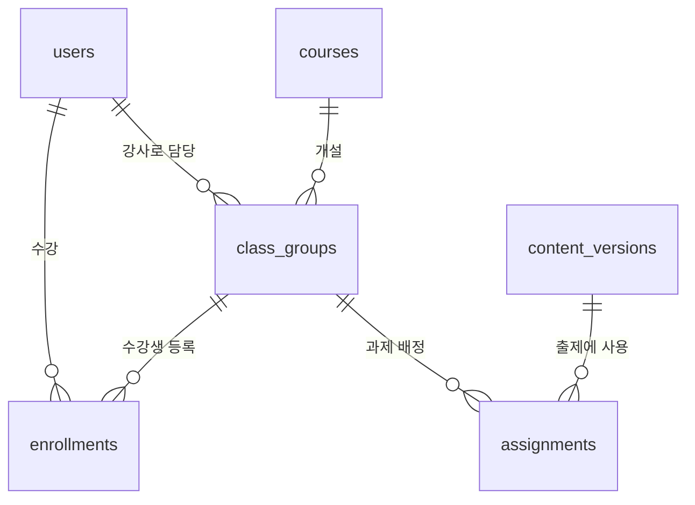
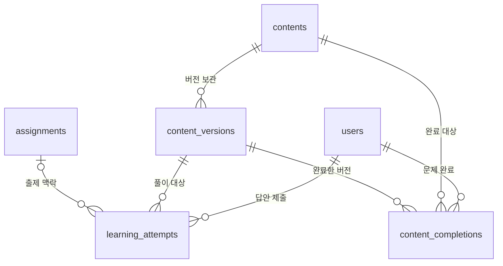
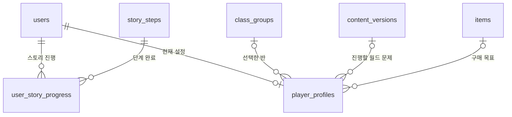
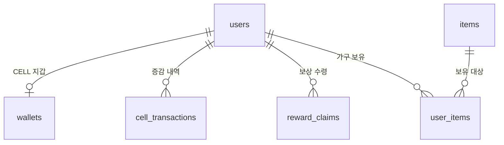

# 도로버스 핵심 ERD

17개 테이블의 논리 관계다. 같은 이름의 테이블이 여러 그림에 나와도 실제로는 하나다. `||`는 정확히 한 개, `o{`는 0개 이상, `o|`는 0개 또는 한 개를 의미한다. [컬럼 정의](table-definitions.md)와 [실제 생성 SQL](../migrations/001_init.sql)을 함께 참고한다.

## 사용자·수업·과제

courses는 교육 내용이고 class_groups는 실제 개설한 반이다. enrollments는 학생과 반을 연결한다. assignments는 반에 어떤 문제 버전을 출제했는지 저장한다.

## 문제·풀이·완료

문제 하나를 두 반에 내도 contents는 하나다. 세 번 제출하면 learning_attempts에 세 행을 남기고, 최초 완료는 content_completions에 한 행을 남긴다. 풀이의 과제·버전 일치와 완료 기록의 문제·버전 일치는 SQL의 복합 FK가 검사한다.

## 스토리·선택 상태

story_steps는 공통 단계, user_story_progress는 개인의 완료 기록이다. player_profiles는 현재 선택과 화면 설정이며 수강·풀이 이력 전체를 대신하지 않는다.

## CELL·상점·보상

wallets는 현재 잔액, cell_transactions는 잔액이 바뀐 이유다. items는 상품 정보, user_items는 사용자의 보유 기록이다. reward_claims는 같은 보상의 중복 수령을 막는다. operation_id는 지급 작업 추적용 값이며 이 그림의 별도 FK가 아니다.
